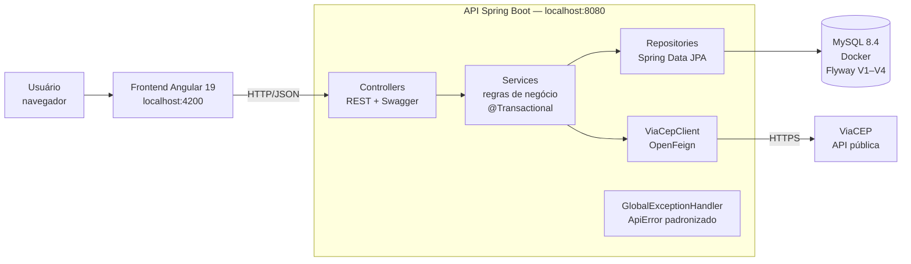
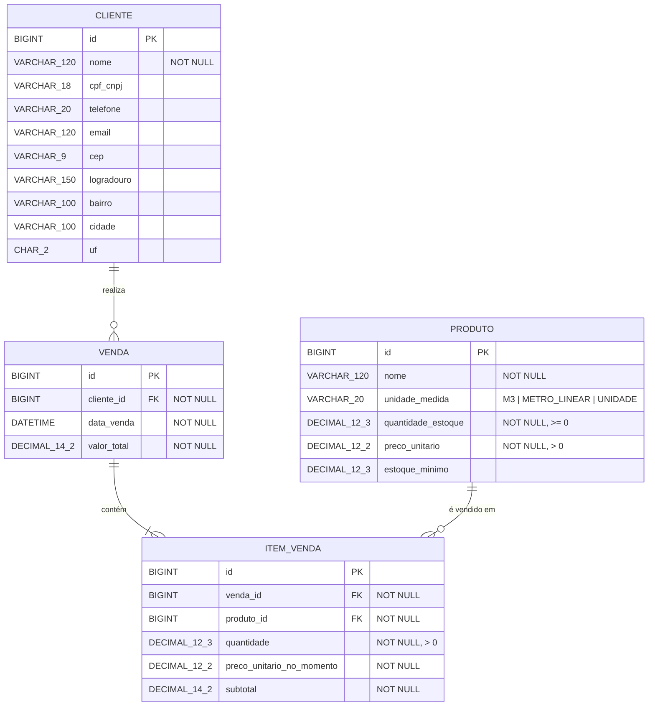
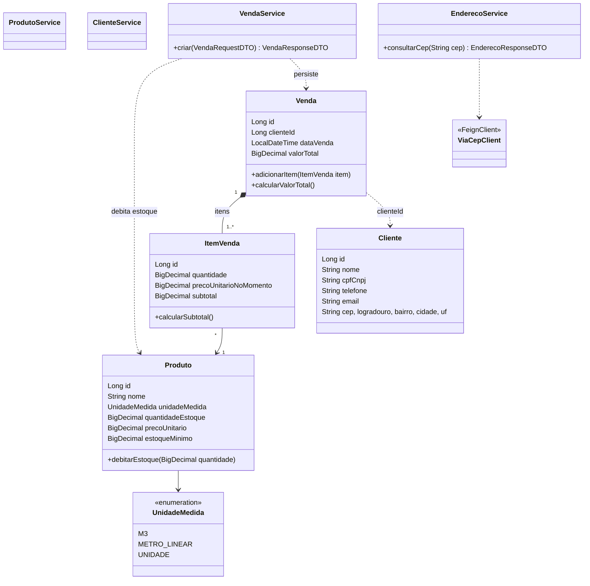
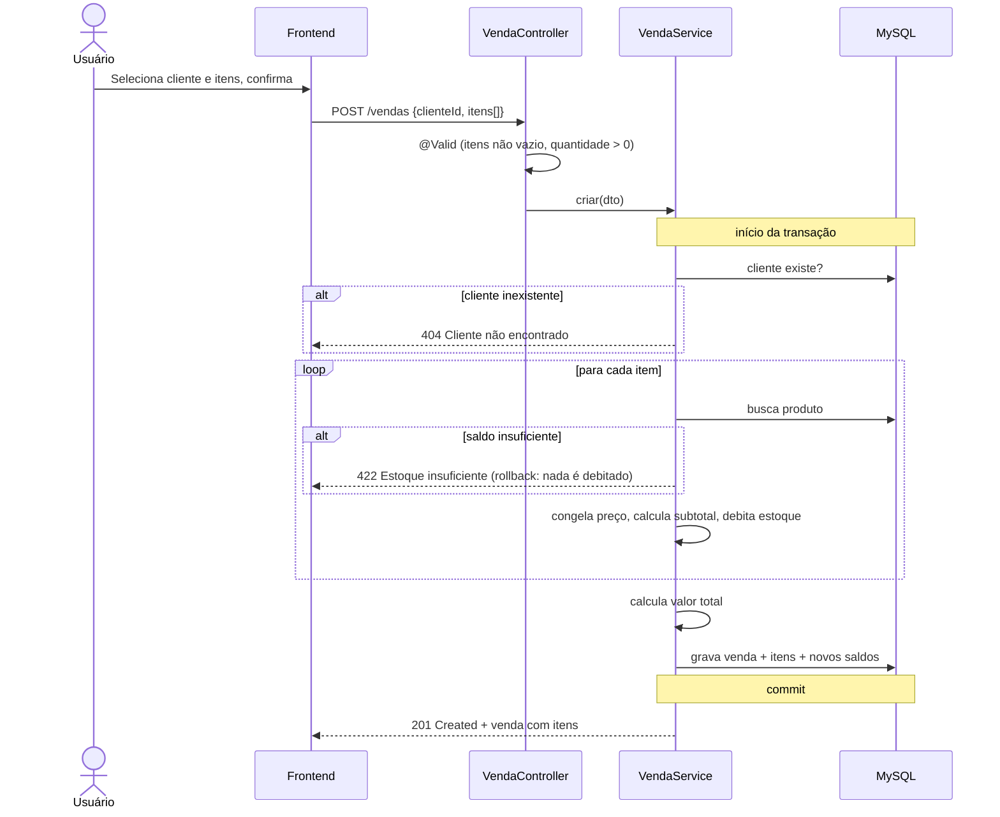

# Estoque Madeireira — Documentação do Sistema (versão final)

| | |
|---|---|
| **Projeto** | Estoque Madeireira |
| **Demandante** | Castelo de Madeira |
| **Integrantes** | Felipe Klaus, Erick Mertz, Paulo Kushino e Wendell Klering |
| **Professora** | Isabel Fernandes |
| **Instituição** | Centro Universitário Descomplica Uniamérica — PIE IV (Spring Boot + Problema Real) |
| **Versão** | 2.0 — atualizada conforme o código entregue (substitui a Especificação de Requisitos v1.0 da Entrega II) |
| **Repositórios** | Backend: https://github.com/pauloKushino/estoque-madeireira · Frontend: https://github.com/pauloKushino/estoque-madeireira-front |

> **Sobre esta versão.** A especificação da Entrega II ("Sistema Castelo — Controle de Estoque, Vendas e Entregas") descrevia o sistema planejado. Este documento descreve o sistema **realmente implementado**. Os requisitos que não foram codificados aparecem marcados como **Trabalho futuro** (seção 3), e não como funcionalidades existentes.

---

## 1. Visão geral

### 1.1 Problema

Na Castelo de Madeira, o saldo de estoque, as vendas e o cadastro de clientes ficavam espalhados entre controles manuais, planilhas e comunicação verbal. As consequências eram divergência entre o saldo registrado e o que havia no pátio, vendas de produto sem saldo e dificuldade para saber quais itens estavam abaixo do mínimo. Como a madeira é vendida em unidades diferentes (m³, metro linear e unidade), o controle manual ficava ainda mais sujeito a erro.

### 1.2 Solução entregue

Um sistema web composto por:

- **API REST** em Java 21 + Spring Boot 4.1.1, com banco MySQL 8.4 (versão do esquema controlada por Flyway);
- **Interface web** em Angular 19, que consome a API.

O escopo entregue cobre o núcleo operacional da madeireira: **produtos e estoque, clientes e vendas com baixa automática de estoque**. O módulo de entregas, a autenticação no servidor e o histórico de movimentações ficaram para versões futuras (seção 3).

### 1.3 Arquitetura



| Camada | Pacote | Responsabilidade |
|---|---|---|
| Controller | `controller/` | Recebe a requisição HTTP, valida o DTO (`@Valid`) e devolve o status HTTP |
| Service | `service/` | Regras de negócio, transações e logs (SLF4J) |
| Repository | `repository/` | Acesso ao banco com Spring Data JPA |
| DTO + Mapper | `dto/` | Contratos de entrada e saída (records Java); a entidade JPA nunca é exposta |
| Entity | `entity/` | Mapeamento JPA das tabelas |
| Exception | `exception/` | Tratamento global de erros (`@RestControllerAdvice`) |
| Client | `client/` | Integração com a API externa ViaCEP |
| Validation | `validation/` | Anotação própria `@CpfCnpj` (valida os dígitos verificadores) |

---

## 2. Tecnologias e versões

| Item | Tecnologia / versão |
|---|---|
| Linguagem | Java 21 |
| Framework | Spring Boot 4.1.1 (Web, Data JPA, Validation) |
| Banco de dados | MySQL 8.4 (Docker, via `docker-compose.yml`) |
| Versionamento do banco | Flyway — migrations V1 a V4, `ddl-auto: validate` |
| Integração externa | Spring Cloud OpenFeign → ViaCEP |
| Documentação da API | SpringDoc OpenAPI (Swagger UI em `/swagger-ui.html`) |
| Testes | JUnit 5, Mockito, `@SpringBootTest` + MockMvc com H2, JaCoCo (mínimo 90% de cobertura de linhas) |
| Teste de carga | Apache JMeter 5.6.3 |
| Frontend | Angular 19, MDBootstrap, SweetAlert2 |

---

## 3. Requisitos: situação final

Legenda: **Implementado** · **Parcial** (parte atendida, detalhe ao lado) · **Trabalho futuro** (não implementado nesta versão).

### 3.1 Requisitos funcionais

| Código | Requisito (Entrega II) | Situação | Como ficou |
|---|---|---|---|
| RF01 | Autenticar usuário | **Parcial** | Tela de login no frontend com usuário fixo (`admin`/`1234`), só para demonstração. Não há autenticação na API. Autenticação real → **trabalho futuro**. |
| RF02 | Controlar autorização por perfil | **Trabalho futuro** | Não há perfis (administrador, vendedor, entregador). |
| RF03 | Cadastrar produtos | **Implementado** | CRUD completo com nome, unidade de medida (M3, METRO_LINEAR, UNIDADE), preço, saldo e estoque mínimo. Sem inativação lógica: a exclusão é física. |
| RF04 | Consultar estoque | **Implementado** | `GET /produtos/{id}/estoque` e listagem com filtro por nome. A interface destaca com "Estoque baixo" os produtos abaixo do mínimo. |
| RF05 | Registrar movimentações (entradas, saídas, ajustes) com histórico | **Parcial** | A saída acontece automaticamente na venda. Entradas e ajustes são feitos editando o saldo do produto, **sem histórico**. Tabela de movimentações → **trabalho futuro**. |
| RF06 | Cadastrar clientes | **Implementado** | CRUD com validação de CPF/CNPJ (dígitos verificadores) e preenchimento do endereço pelo CEP (ViaCEP). |
| RF07 | Registrar venda com um ou mais itens | **Implementado** | `POST /vendas` com cliente e lista de itens. A venda não registra o vendedor, porque não há usuários. |
| RF08 | Validar quantidades | **Implementado** | Quantidade > 0, produto e cliente existentes, saldo suficiente para **todos** os itens. |
| RF09 | Calcular subtotais e total | **Implementado** | Subtotal = quantidade × preço (2 casas, arredondamento HALF_UP); total = soma dos subtotais. |
| RF10 | Atualizar estoque na venda | **Implementado** | Baixa de estoque na mesma transação da venda. |
| RF11 | Criar entrega vinculada à venda | **Trabalho futuro** | Módulo de entregas não implementado. |
| RF12 | Atribuir entregador | **Trabalho futuro** | — |
| RF13 | Listar entregas do entregador | **Trabalho futuro** | — |
| RF14 | Atualizar status da entrega | **Trabalho futuro** | — |
| RF15 | Entrega parcial | **Trabalho futuro** | — |
| RF16 | Entrega completa | **Trabalho futuro** | — |
| RF17 | Registrar data e hora da conclusão | **Trabalho futuro** | (A venda registra data e hora: `dataVenda`.) |
| RF18 | Registrar usuário responsável | **Trabalho futuro** | Depende de RF01/RF02. |
| RF19 | Consultar histórico | **Parcial** | Histórico de vendas com itens (`GET /vendas`, `GET /vendas/{id}`). Histórico de entregas → **trabalho futuro**. |
| RF20 | Dashboard com indicadores | **Parcial** | Há o indicador de estoque baixo na tela de produtos. Painel com vendas recentes e entregas pendentes → **trabalho futuro**. |

### 3.2 Requisitos não funcionais

| Código | Categoria | Situação | Evidência / observação |
|---|---|---|---|
| RNF01 | Usabilidade | **Implementado** | Telas de Produtos, Clientes e Vendas com busca, formulários e mensagens de erro vindas da API. |
| RNF02 | Responsividade | **Parcial** | Layout com MDBootstrap; não houve ajuste nem teste específico para celular. |
| RNF03 | Desempenho | **Parcial** | Teste de carga (seção 7): consultas com 50 usuários simultâneos tiveram média de 38 ms e 0% de erro. Com muitas vendas simultâneas do mesmo produto, o sistema apresentou falhas de concorrência. |
| RNF04 | Segurança (senha, autenticação) | **Trabalho futuro** | Não há autenticação na API. |
| RNF05 | Autorização no back-end | **Trabalho futuro** | — |
| RNF06 | Integridade | **Parcial** | Chaves estrangeiras, `CHECK` de estoque ≥ 0 e preço > 0 no banco, transação na venda. Em vendas simultâneas do mesmo produto, o teste de carga mostrou baixas de estoque perdidas (seção 7). |
| RNF07 | Persistência | **Implementado** | MySQL; esquema versionado por Flyway. |
| RNF08 | Manutenibilidade | **Implementado** | Camadas separadas, DTOs, 100 testes automatizados (64 unitários, 35 de integração e 1 de inicialização), cobertura de 99% das linhas (mínimo de 90% verificado no build). |
| RNF09 | Padronização da API | **Implementado** | REST com verbos e status HTTP coerentes; documentação Swagger. |
| RNF10 | Tratamento de erros | **Implementado** | Todas as falhas retornam o mesmo formato `ApiError` (seção 5.1). |
| RNF11 | Auditabilidade | **Trabalho futuro** | Sem registro de usuário nas alterações. |
| RNF12 | Compatibilidade com navegadores | **Implementado** | Aplicação Angular padrão, testada no navegador. |

### 3.3 Regras de negócio

| Código | Regra (Entrega II) | Situação |
|---|---|---|
| RN01 | Venda deve ter ao menos um item válido | **Implementado** (HTTP 400) |
| RN02 | Quantidade de cada item > 0 | **Implementado** (HTTP 400) |
| RN03 | Produto inativo não entra em venda | **Trabalho futuro** (não há campo "ativo") |
| RN04 | Baixa de estoque transacional | **Implementado** (`@Transactional`; ver limitação na seção 7) |
| RN05 | Ajuste manual só por usuário autorizado | **Trabalho futuro** |
| RN06 a RN09 | Regras de entrega | **Trabalho futuro** |
| RN10 | Registrar usuário e momento de alterações críticas | **Parcial**: só o momento da venda |

Regras **acrescentadas** durante o desenvolvimento, que já estão implementadas:

| Regra | Como funciona |
|---|---|
| **Venda "tudo ou nada"** | O saldo de todos os itens é verificado antes de gravar. Se um único item não tiver saldo, a venda inteira é recusada (HTTP 422) e nada é debitado. |
| **Estoque nunca negativo** | Três travas: verificação no `VendaService`, verificação no método `Produto.debitarEstoque` e `CHECK (quantidade_estoque >= 0)` no banco. |
| **Preço congelado** | Cada item guarda `precoUnitarioNoMomento`. Se o preço do produto mudar depois, as vendas antigas não são alteradas. |
| **CPF/CNPJ válido** | A anotação `@CpfCnpj` confere os dígitos verificadores (o campo é opcional). |
| **CEP automático** | Ao informar o CEP, o endereço vem da ViaCEP. CEP inexistente → 404; ViaCEP fora do ar → 502. |

---

## 4. Modelo de dados

### 4.1 Diagrama entidade-relacionamento (banco atual)



### 4.2 Tabelas

| Tabela | Migration | Restrições |
|---|---|---|
| `cliente` | V1 | PK `id` |
| `produto` | V2 | PK `id`; `chk_produto_estoque_positivo` (estoque ≥ 0); `chk_produto_preco_positivo` (preço > 0) |
| `venda` | V3 | PK `id`; `fk_venda_cliente` → `cliente(id)` |
| `item_venda` | V3 | PK `id`; `fk_item_venda_venda` → `venda(id)`; `fk_item_venda_produto` → `produto(id)`; `chk_item_quantidade_positiva` (quantidade > 0) |

A migration **V4** carrega os dados de exemplo: 5 produtos (o "Dormente de Acácia" fica de propósito abaixo do estoque mínimo, para demonstrar o indicador) e 3 clientes.

### 4.3 Diferenças em relação ao modelo planejado (Entrega II)

| Planejado | Implementado |
|---|---|
| `Usuario` (login, senhaHash, perfil) | Não existe → trabalho futuro |
| `Estoque` (tabela separada) | O saldo fica no próprio `produto.quantidade_estoque` |
| `MovimentacaoEstoque` | Não existe → trabalho futuro |
| `Venda.vendedorId`, `Venda.status` | Não existem (sem usuários; a venda já nasce confirmada) |
| `Entrega`, `ItemEntrega` | Não existem → trabalho futuro |
| `Produto.ativo` / `descricao` | Não existem; produto tem `estoque_minimo` e `unidade_medida` |
| — | `ItemVenda.preco_unitario_no_momento` (preço congelado) |

### 4.4 Diagrama de classes (domínio e serviços)



### 4.5 Fluxo de registro de venda



---

## 5. Endpoints da API

URL base: `http://localhost:8080` · Documentação interativa: `http://localhost:8080/swagger-ui.html`

> Na Entrega II as rotas foram previstas com o prefixo `/api` (ex.: `/api/produtos`). Na implementação final elas ficaram **sem o prefixo**: `/produtos`, `/clientes`, `/vendas`, `/enderecos`.

### 5.1 Formato padrão de erro

Toda falha devolve o mesmo corpo (`ApiError`):

```json
{
  "timestamp": "2026-11-23T17:21:30.4030235",
  "status": 404,
  "error": "Not Found",
  "message": "Produto nao encontrado: id 999",
  "path": "/produtos/999"
}
```

| Status | Quando acontece |
|---|---|
| 200 | Consulta ou atualização bem-sucedida |
| 201 | Recurso criado (POST) |
| 204 | Exclusão bem-sucedida (DELETE) |
| 400 | Dados inválidos (Bean Validation, CPF/CNPJ inválido, CEP com formato errado) |
| 404 | Recurso inexistente (produto, cliente, venda, CEP) ou rota inexistente |
| 422 | Estoque insuficiente na venda |
| 502 | ViaCEP indisponível |
| 500 | Erro inesperado (mensagem genérica; detalhe só no log do servidor) |

### 5.2 Resumo

| Método | Rota | Descrição | Sucesso | Erros |
|---|---|---|---|---|
| GET | `/produtos` | Lista produtos (filtro opcional `?nome=`) | 200 | — |
| GET | `/produtos/{id}` | Busca produto | 200 | 404 |
| GET | `/produtos/{id}/estoque` | Saldo disponível do produto | 200 | 404 |
| POST | `/produtos` | Cadastra produto | 201 | 400 |
| PUT | `/produtos/{id}` | Atualiza produto | 200 | 400, 404 |
| DELETE | `/produtos/{id}` | Exclui produto | 204 | 404 |
| GET | `/clientes` | Lista clientes (filtro opcional `?nome=`) | 200 | — |
| GET | `/clientes/{id}` | Busca cliente | 200 | 404 |
| POST | `/clientes` | Cadastra cliente | 201 | 400 |
| PUT | `/clientes/{id}` | Atualiza cliente | 200 | 400, 404 |
| DELETE | `/clientes/{id}` | Exclui cliente | 204 | 404 |
| GET | `/vendas` | Lista vendas com itens | 200 | — |
| GET | `/vendas/{id}` | Busca venda com itens | 200 | 404 |
| POST | `/vendas` | Registra venda e debita o estoque | 201 | 400, 404, 422 |
| GET | `/enderecos/{cep}` | Consulta endereço pelo CEP (ViaCEP) | 200 | 400, 404, 502 |

Os exemplos abaixo foram obtidos executando a API com os dados de exemplo da migration V4.

### 5.3 Produtos

#### `GET /produtos?nome=pinus` — lista com filtro

Resposta `200 OK`:
```json
[
  {
    "id": 1,
    "nome": "Tabua de Pinus 25cm",
    "unidadeMedida": "M3",
    "quantidadeEstoque": 45.500,
    "precoUnitario": 850.00,
    "estoqueMinimo": 10.000
  }
]
```

#### `GET /produtos/1` — busca por id

Resposta `200 OK`:
```json
{ "id": 1, "nome": "Tabua de Pinus 25cm", "unidadeMedida": "M3", "quantidadeEstoque": 45.500, "precoUnitario": 850.00, "estoqueMinimo": 10.000 }
```

Resposta `404 Not Found` (`GET /produtos/999`):
```json
{ "timestamp": "2026-11-23T17:21:30.4030235", "status": 404, "error": "Not Found", "message": "Produto nao encontrado: id 999", "path": "/produtos/999" }
```

#### `GET /produtos/5/estoque` — saldo disponível

Resposta `200 OK`:
```json
{ "produtoId": 5, "nomeProduto": "Dormente de Acacia 2.4m", "quantidadeDisponivel": 8.000, "unidadeMedida": "UNIDADE" }
```

#### `POST /produtos` — cadastro

Requisição:
```json
{
  "nome": "Caibro de Pinus 5x5",
  "unidadeMedida": "METRO_LINEAR",
  "quantidadeEstoque": 300,
  "precoUnitario": 8.90,
  "estoqueMinimo": 50
}
```
Resposta `201 Created`:
```json
{ "id": 6, "nome": "Caibro de Pinus 5x5", "unidadeMedida": "METRO_LINEAR", "quantidadeEstoque": 300, "precoUnitario": 8.90, "estoqueMinimo": 50 }
```

Requisição inválida → `400 Bad Request`:
```json
// requisição
{ "nome": "", "unidadeMedida": "UNIDADE", "quantidadeEstoque": -1, "precoUnitario": 0 }
// resposta
{ "status": 400, "error": "Bad Request", "message": "quantidadeEstoque: quantidadeEstoque nao pode ser negativa; precoUnitario: precoUnitario deve ser maior que zero; nome: nome e obrigatorio", "path": "/produtos" }
```

Campos: `nome` (obrigatório, até 120), `unidadeMedida` (obrigatório: `M3`, `METRO_LINEAR` ou `UNIDADE`), `quantidadeEstoque` (obrigatório, ≥ 0), `precoUnitario` (obrigatório, > 0), `estoqueMinimo` (opcional, ≥ 0).

#### `PUT /produtos/6` — atualização

Requisição: mesmo formato do POST (ex.: `"precoUnitario": 9.50`). Resposta `200 OK`:
```json
{ "id": 6, "nome": "Caibro de Pinus 5x5", "unidadeMedida": "METRO_LINEAR", "quantidadeEstoque": 300, "precoUnitario": 9.50, "estoqueMinimo": 50 }
```

#### `DELETE /produtos/6` — exclusão

Resposta `204 No Content` (sem corpo).

### 5.4 Clientes

#### `GET /clientes/2` — busca por id

Resposta `200 OK`:
```json
{
  "id": 2,
  "nome": "Marcenaria Arte em Madeira",
  "cpfCnpj": "07.526.557/0001-00",
  "telefone": "4133224455",
  "email": "contato@artemadeira.com",
  "cep": "80010-000",
  "logradouro": "Rua XV de Novembro",
  "bairro": "Centro",
  "cidade": "Curitiba",
  "uf": "PR"
}
```

`GET /clientes` devolve a lista no mesmo formato; `GET /clientes?nome=marcenaria` filtra por nome.

#### `POST /clientes` — cadastro

Requisição:
```json
{
  "nome": "Carpintaria Iguacu",
  "cpfCnpj": "11.444.777/0001-61",
  "telefone": "45999990000",
  "email": "contato@carpintaria.com",
  "cep": "85853-000",
  "logradouro": "Avenida das Cataratas",
  "bairro": "Vila Yolanda",
  "cidade": "Foz do Iguacu",
  "uf": "PR"
}
```
Resposta `201 Created`: o mesmo objeto com `"id": 4`.

CPF/CNPJ inválido → `400 Bad Request`:
```json
// requisição
{ "nome": "Teste", "cpfCnpj": "123.456.789-00" }
// resposta
{ "status": 400, "error": "Bad Request", "message": "cpfCnpj: cpfCnpj invalido: informe um CPF (11 digitos) ou CNPJ (14 digitos) valido", "path": "/clientes" }
```

Campos: `nome` (obrigatório, até 120); opcionais: `cpfCnpj` (CPF ou CNPJ válido), `telefone`, `email` (formato de e-mail), `cep` (`00000-000`), `logradouro`, `bairro`, `cidade`, `uf` (2 letras).

#### `PUT /clientes/4` e `DELETE /clientes/4`

PUT: mesmo formato do POST → `200 OK` com o cliente atualizado. DELETE → `204 No Content`.

### 5.5 Vendas

#### `POST /vendas` — registra venda e baixa o estoque

Requisição:
```json
{
  "clienteId": 1,
  "itens": [
    { "produtoId": 1, "quantidade": 2.5 },
    { "produtoId": 4, "quantidade": 10 }
  ]
}
```
Resposta `201 Created`:
```json
{
  "id": 1,
  "clienteId": 1,
  "dataVenda": "2026-11-23T17:21:31.6570094",
  "valorTotal": 3975.00,
  "itens": [
    { "id": 1, "produtoId": 1, "nomeProduto": "Tabua de Pinus 25cm", "quantidade": 2.5, "precoUnitarioNoMomento": 850.00, "subtotal": 2125.00 },
    { "id": 2, "produtoId": 4, "nomeProduto": "Compensado Naval 18mm", "quantidade": 10, "precoUnitarioNoMomento": 185.00, "subtotal": 1850.00 }
  ]
}
```
Depois da venda, o saldo da Tábua de Pinus passa de 45,5 para 43,0 m³ e o do Compensado Naval de 60 para 50 unidades.

Estoque insuficiente → `422 Unprocessable Entity`. Nenhum item é debitado, nem o que tinha saldo:
```json
// requisição: 5 Ripões (há 200) + 9 Dormentes (há 8)
{ "clienteId": 2, "itens": [ { "produtoId": 3, "quantidade": 5 }, { "produtoId": 5, "quantidade": 9 } ] }
// resposta
{ "status": 422, "error": "Unprocessable Entity", "message": "Estoque insuficiente para o produto 'Dormente de Acacia 2.4m' (id 5): disponivel 8.000 UNIDADE, solicitado 9", "path": "/vendas" }
```

Venda sem itens → `400`:
```json
{ "status": 400, "error": "Bad Request", "message": "itens: a venda deve ter ao menos um item", "path": "/vendas" }
```

Cliente inexistente → `404`:
```json
{ "status": 404, "error": "Not Found", "message": "Cliente nao encontrado: id 99", "path": "/vendas" }
```

#### `GET /vendas/1` e `GET /vendas`

Devolvem a venda (ou a lista de vendas) no mesmo formato da resposta do POST.

### 5.6 Endereços (integração ViaCEP)

#### `GET /enderecos/85853000`

Resposta `200 OK`:
```json
{ "cep": "85853-000", "logradouro": "Avenida das Cataratas", "bairro": "Yolanda", "cidade": "Foz do Iguaçu", "uf": "PR" }
```

| Caso | Exemplo | Resposta |
|---|---|---|
| Formato inválido | `GET /enderecos/123` | `400` — "CEP invalido: informe 8 digitos numericos" |
| CEP inexistente | `GET /enderecos/99999999` | `404` — "CEP nao encontrado: 99999999" |
| ViaCEP fora do ar | (sem internet) | `502` — "Servico externo indisponivel no momento. Tente novamente." |

---

## 6. Interface web (frontend)

| Tela | Funcionalidades |
|---|---|
| Login | Acesso de demonstração (`admin` / `1234`), validado apenas no navegador |
| Produtos | Listagem, busca por nome, cadastro, edição, exclusão e selo "Estoque baixo" quando o saldo está abaixo do mínimo |
| Clientes | Listagem, busca, cadastro, edição e exclusão; preenchimento automático do endereço ao digitar o CEP |
| Vendas | Listagem e detalhes; nova venda com itens adicionados dinamicamente e total calculado em tempo real |

As mensagens de erro da API (campo `message` do `ApiError`) são exibidas ao usuário por um interceptor HTTP único.

---

## 7. Qualidade: testes e limitações conhecidas

### 7.1 Testes automatizados

| Tipo | Ferramenta | Quantidade |
|---|---|---|
| Unitários | JUnit 5 + Mockito | 64 (services e validador de CPF/CNPJ) |
| Integração | `@SpringBootTest` + MockMvc + H2 (mesmas migrations do Flyway) | 35 |
| Inicialização | `@SpringBootTest` (contexto completo) | 1 |
| Cobertura | JaCoCo | **99% das linhas** (389 de 393) na execução de 23/11/2026; o build falha se ficar abaixo de 90% |

Resultado da última execução de `mvnw verify`: **100 testes, 0 falhas**.

### 7.2 Teste de carga (JMeter)

Detalhes em [`carga/README.md`](../carga/README.md).

| Cenário | Usuários | Vazão | Tempo médio | Erros |
|---|---:|---:|---:|---:|
| Consulta de catálogo | 50 | 192 req/s | 38 ms | 0% |
| Vendas simultâneas (mesmos produtos) | 20 | 72 req/s | 54 ms | 24,5% |
| Pico misto | 200 | 30 req/s | 4.772 ms | 3,6% |

### 7.3 Limitações conhecidas

| Limitação | Impacto | Correção sugerida |
|---|---|---|
| Vendas **simultâneas do mesmo produto** podem perder baixas de estoque e gerar deadlock no MySQL (erro 500) | Em operação real com vários vendedores ao mesmo tempo, o saldo pode ficar maior que o real | Ler os produtos com lock pessimista (`@Lock(PESSIMISTIC_WRITE)`, sempre na mesma ordem de id) ou fazer a baixa com `UPDATE ... WHERE quantidade_estoque >= :qtd` |
| `GET /vendas` devolve todas as vendas, sem paginação | Fica lento com muitas vendas | Paginação (`Pageable`) |
| Excluir produto ou cliente que já tem venda retorna erro 500 (violação de chave estrangeira) | Mensagem genérica para o usuário | Tratar como 409 Conflict ou usar inativação lógica |
| Sem autenticação na API | Qualquer pessoa na rede pode chamar a API | Spring Security + JWT (trabalho futuro) |

---

## 8. Trabalhos futuros

Por prioridade, a partir do que foi levantado na Entrega II:

1. **Corrigir a concorrência na baixa de estoque** (seção 7.3), antes de usar com vários vendedores.
2. **Autenticação e perfis** (RF01, RF02, RNF04, RNF05): Spring Security com JWT; perfis administrador, vendedor e entregador.
3. **Módulo de entregas** (RF11 a RF18, RN06 a RN09): entrega vinculada à venda, entregador, status, entrega parcial e completa.
4. **Movimentações de estoque com histórico** (RF05): entradas, ajustes e saídas registrados com data e usuário.
5. **Inativação lógica** de produtos e clientes (RN03), no lugar da exclusão física.
6. **Dashboard** (RF20): vendas recentes, entregas pendentes e produtos com estoque baixo.
7. Itens já adiados na Entrega II: emissão fiscal, pagamentos, roteirização, geolocalização e aplicativo móvel.

---

## 9. Como executar

Pré-requisitos: Docker Desktop, Java 21 e Node.js 20+.

```powershell
# Backend (pasta estoque-madeireira)
docker compose up -d          # MySQL na porta 3306 (usuário root / senha root)
.\mvnw.cmd spring-boot:run    # API em http://localhost:8080

# Frontend (pasta estoque-madeireira-front)
npm install
npm start                     # http://localhost:4200  (login: admin / 1234)
```

As migrations do Flyway criam as tabelas e carregam os dados de exemplo automaticamente na primeira execução.
